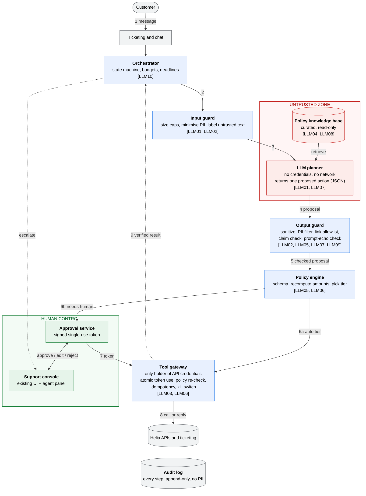

# Helia support agent: design

**Core idea:** the model proposes, deterministic code decides, and one tool gateway is the only thing that can touch Helia's APIs. Every irreversible action has a named human approver. That is either the support agent who approved that specific action, or the accountable owner (Finance for money, the support lead for replies) who approved the capped standing rule that allowed it. Prompts are never a security control.

**Assumptions** (not stated in the brief):

- About 5,000 cases a day.
- "A few seconds" means automated latency (from message received to reply sent or approval card ready) has p95 under 10 s for read-only answers. Time spent waiting for a human approver is measured separately.
- Hard cost cap of $0.10 of model spend per case. This is a placeholder; Finance sets the real value.
- Helia's APIs are internal services we can put a gateway in front of. Only the gateway holds their credentials.
- The existing support console can host a side panel. Ticketing stays the system of record.
- The model provider contract guarantees zero data retention and no training on our data.

**Sources of truth:** approval rules and their numbers live in [approval-policy.example.yaml](../standards/approval-policy.example.yaml). Tool contracts live in [standards/manifests/](../standards/manifests/). Engineering process lives in [team-standard.md](team-standard.md). This document explains *why*; where it quotes a number, the files above win. CI (`scripts/validate.py`) checks that they agree.

## 1. Architecture

Red is untrusted, blue is deterministic code we control, green is human, grey is a system of record. Solid arrows are the request path; dotted arrows are feedback (verified results, escalation). Every step writes to the audit log. Tags such as `[LLM06]` are the OWASP LLM Top 10 (2025) risks that component mitigates; see [owasp-llm-top10.md](owasp-llm-top10.md).

**How a request becomes an action** (numbers match the diagram):

1. The customer's message arrives through ticketing. Ticketing stays the system of record.
2. The orchestrator opens a case run with a budget and a deadline, and binds it to one customer ID.
3. The input guard prepares what the model sees:
   - It enforces size caps.
   - It strips fields the model does not need (card data, secrets, internal notes).
   - It wraps customer text and account fields as labelled untrusted data.
   - It offers only the tools allowed in the current state and phase.
4. The model returns one structured proposal: answer, call a tool, ask the customer, or escalate. Any ID it picks (for example, a charge) must come from candidates the server returned earlier in this case.
5. For replies, the output guard checks the text:
   - It sanitizes HTML and markdown.
   - It removes or blocks PII and foreign identifiers.
   - It allows links only to allowlisted domains.
   - It checks that every amount, date, plan, and policy statement traces to a tool result or a knowledge-base passage ID.
   - It flags prompt echoes.

   It sets `guard_passed` and `claims_verified`; the model cannot set them. Proposals that are not replies pass through to the policy engine.
6. The policy engine validates the proposal against the tool manifest, recomputes amounts and currency from source data, and picks a decision. Reads and earned-auto actions go straight to the gateway (6a). Everything else becomes an approval card (6b). A human edit creates a new proposal, which goes through steps 5 and 6 again.
7. A support agent approves, edits, or rejects the card. Approval mints a signed token bound to the exact action.
8. The gateway enforces the rules in section 3, then calls the Helia API or sends the reply through ticketing.
9. The gateway reads state back and reports `done`, `initiated` (for example, a refund that is still pending), or `failed`. The orchestrator then continues, replies, or escalates.

## 2. The agent loop

The orchestrator owns the loop, not the model. Each turn runs **gather, plan, check, approve, execute, verify, reply**:

- **Gather:** read-only lookups, scoped to the case's customer. An injected "look up jane@other.com" is denied by the gateway. Reads run in parallel, bounded by the limits below.
- **Plan:** a small triage model classifies intent. The planner model is called only when a case needs a tool or a multi-step answer. It sees only the tools valid for the current state.
- **Verify:** after every write, the gateway reads the record back. A reply may only state what was verified:
  - "Refunded" requires `done`.
  - A pending refund is `initiated`, and the reply may only say "your refund has been initiated and usually arrives in 5 to 10 business days".

**Budgets per model** (per case unless noted):

| | Calls | Input tokens per call | Output tokens per call | Timeout per call |
|---|---|---|---|---|
| Triage model | up to 2 | 4k | 200 | 2 s |
| Planner model | up to 4 (max 2 per turn) | 8k | 800 | 6 s |

The hard cap is $0.10 per case, whichever limit is hit first. At release, the eval harness computes the worst allowed case at the approved models' current prices (all calls at maximum tokens) and fails the release if it exceeds the cap. A price or model change re-runs that check. This replaces a single "60k tokens" number, which did not fit every model.

**Limits and deadlines:**

- **Inbound message:** up to 8,000 characters. Longer messages are truncated, and the case is flagged for a human.
- **Attachments:** never sent to the model.
- **Conversation history:** the last 10 messages; anything older is summarized by code.
- **Retrieval:** top 5 passages, at most 3k tokens in total.
- **Reads:** at most 4 in parallel and 8 per turn. Each tool call has a 3 s timeout.
- **Write proposals:** at most 2 per case.
- **Concurrency:** one active run per customer (new messages queue behind it). Model calls have a global in-flight cap. If the queue wait exceeds 5 s, the case goes straight to the human queue instead of waiting.
- **Deadline:** 20 s of automated work per turn. At the deadline, the case escalates.

**Latency targets:**

- Automated latency, p95 under 10 s for read-only answers.
- Human approval wait, tracked separately: median under 2 minutes and p95 under 15 minutes during staffed hours.

**When it stops:**

- The goal is met and verified.
- Any budget, limit, or deadline above is hit.
- Policy denies the same proposal twice, or the model repeats a proposal (loop detection).
- Escalation triggers fire: legal or chargeback language, a security or account-takeover signal, a data request, or a distressed customer.

Stopping always escalates with a summary. It never silently retries.

**Retries:** invalid model output gets one repair attempt. Transient tool errors (timeout, 5xx, 429) get at most two retries with backoff and the same idempotency key. Uncertainty is never retried; it escalates.

**When the model is confidently wrong:** we never use model confidence to authorize anything. Four layers catch errors:

1. The policy engine recomputes amounts and currency and bounds every field.
2. The output guard blocks reply claims that do not trace to a source.
3. Humans approve writes until each action type earns autonomy.
4. Read-back verification, nightly reconciliation, and QA sampling catch what slips through.

## 3. Human-in-the-loop line

| Action | Risk tier | Launch (phases 0 to 2) | Earned auto (phase 3) | Always human or denied |
|---|---|---|---|---|
| `look_up_account` | R0 read | Auto, bound to the case's customer | Auto | Reading any other customer is denied |
| `escalate_to_human` | R0 | Auto, always available | Auto | - |
| `reply_to_customer` | R3 (cannot unsend) | Phase 1: human approves every reply. Phase 2: informational answers auto-send under a standing rule (support lead) | Also confirmations of actions the gateway read back as `done` | Legal, chargeback, security, or cancellation topics; any output guard or claim failure |
| `change_plan` | R2 | Human | Upgrades up to $100 proration, only after the customer clicks a signed confirm link (not model-read text) | Downgrades, or any change that loses data |
| `update_account` | R2 | Human | Low-risk profile fields (display name, notification settings, language) | Email, owner, payment method, billing address |
| `issue_refund` | R3 (cannot undo) | Human | Up to USD 50 under a standing rule (Finance): one charge, inside the refund window, at most one agent refund per customer per 90 days | Anything above USD 50; any non-USD refund until per-currency caps exist; a currency mismatch is denied |

All earned-auto rules ship disabled. Each is enabled by its own merge request when its rollout gate passes.

**Standing approvals count as approval.** For an R3 action, an auto rule is valid only if it is capped, and if its enabling merge request is approved by the accountable owner: Finance for refunds, the support lead for replies. That approver's identity and the rule ID are recorded as `approver_id` and `policy_rule_id` on every action the rule authorizes. Finance and Legal therefore always get a named approver.

**Where approval is enforced:** in the tool gateway, not in the prompt and not in the console UI. Before any write, the gateway does five things:

1. **Re-evaluates policy** with its own copy of the active policy version. A `deny` stops the action. `auto` proceeds. `human` requires a token.
2. **Verifies the token:**
   - signed by the approval service
   - bound to a hash of (tool, canonical parameters, case ID, policy version)
   - not expired (15 minutes)
   - holder has the `action_approver` role with a fresh SSO session
3. **Rejects stale tokens:** if the token's policy version differs from the gateway's active version, the action goes back for re-approval.
4. **Consumes the token atomically:** a compare-and-set on `token_id` happens *before* calling Helia. Any second use, including a concurrent one, is rejected.
5. **Fails closed on audit:** it writes the "intent" audit event durably first. If that write fails, nothing executes. The result event is written after read-back.

The model never sees or produces tokens. If a human edits a proposal, it is re-checked by the output guard and the policy engine, and the editor is recorded as the approver.

**Who approves individual actions:** any trained support agent with the `action_approver` role. Refunds have no amount tiers (decision D2). This keeps the queue moving, at the cost of weaker separation of duties on large refunds. We compensate with detection: Finance gets a daily digest per approver (count and total), and a reconciliation mismatch trips the kill switch. A second approver above a threshold is a one-line policy change.

## 4. Failure and rollback

- **Partial failure:** every case run is a saga with durable step state.
  - Reversible steps run first and irreversible steps run last (for example, change the plan, then refund the prorated difference).
  - Every write carries an idempotency key derived from the case, the step, and the parameters.
  - If the outcome is unknown (timeout after send), the gateway reads state back before any retry.
  - If a step cannot complete, completed reversible steps are compensated and the case escalates with its full timeline.
- **Compensation store:** before-images needed for undo live in a dedicated store, never in the audit log.
  - Encrypted with its own key.
  - Write access: the gateway only. Read access: the compensation flow only. Every read is audited.
  - Retention: the tool's undo window plus 30 days, then hard-deleted.
  - The audit log keeps only a reference and a hash (`before_image_ref`).
- **Undo per tool** (each manifest documents its undo):
  - `change_plan`: change back to the previous plan. No PII is involved. Pre-authorized within one hour by the original approval.
  - `update_account`: restore the before-image from the compensation store, with human approval.
  - `reply_to_customer`: cannot be undone. Send a human-approved correction.
  - `issue_refund`: cannot be undone by the agent. Recovery goes through Finance. This is why refunds have the strictest gate.
- **Catching wrong actions:**
  - Read-back after every write.
  - Nightly Finance reconciliation: every agent refund in the ledger must map to an approval token or a standing-rule decision. An orphan is a Sev1 and disables the tool.
  - A 2% QA sample of auto-handled cases.
  - Reopen and complaint signals.
- **What the customer sees:** honest status only. "Done" wording requires a `done` read-back. `initiated` gets "initiated" wording. On failure: "A specialist is taking this over; you will hear back within X." Internal errors are never shown.
- **What the support agent sees:** the side panel shows the case timeline: proposed versus executed actions, step status (done, initiated, failed, compensated), the policy rule that fired, and one-click "take over".

## 5. Guardrails for engineers

The full rules are in [team-standard.md](team-standard.md). The mechanics:

- **One registration path:** a tool exists only if it has a manifest in [standards/manifests/](../standards/manifests/), built from the [template](../standards/tool-manifest.template.yaml) and validated against a JSON Schema. It declares:
  - risk tier
  - input bounds
  - which fields the model may choose (enums, bounded values, or IDs from server-provided candidates) and which are derived server-side
  - currency
  - idempotency
  - verify states
  - undo
  - rate limits
  - PII fields

  The gateway rejects unregistered tools. Each tool gets its own least-privilege credential.
- **Policy as code:** one versioned bundle with boundary tests in [policy-tests.yaml](../standards/policy-tests.yaml). Money rules need a Finance code owner.
- **CI on every merge request** checks:
  - schema and semantic validation of manifests
  - policy invariants: default is human, floors outrank auto rules, auto rules start disabled with a cap, R3 auto rules have a standing approver
  - policy boundary tests
  - that the section 3 table, the policy, and the manifests agree
  - that audit-field lists agree across files
  - links, Mermaid rendering, and em dashes
- **Testing before release:** prompts, models, policies, and tools are versioned artifacts released through the same pipeline. Each release needs:
  - contract tests against the Helia sandbox
  - the policy boundary tests
  - a golden-case eval set
  - an adversarial eval set: injection in messages, account fields, and knowledge-base documents; impersonation; multi-turn manipulation
  - the worst-case cost check

  Release gate: zero unauthorized writes executed, at least 98% correct escalation on the adversarial set, and no regression above 2 points on the golden set. Model or prompt changes also replay a week of shadow traffic.
- **Logging:** one audit event per step. The required fields are listed in the team standard. Logs are append-only, PII is redacted, and retention is set by Legal.
- **Review:** Greptile must reach 5/5 (driven by the greploop skill), plus human code owners for the area changed.

## 6. Rollout

| Phase | Scope | Agent can | Exit gate |
|---|---|---|---|
| 0 Shadow (2 weeks) | Copy of real traffic | Read and draft; nothing is shown or sent | At least 85% agreement with human outcomes, cost and automated latency within budget, adversarial suite clean |
| 1 Assist | One Payments queue and one Accounts queue, 10% then 50% | Drafts and proposals in the console; humans approve everything | At least 90% approved without edits per action type over 500 or more cases, zero Sev1 |
| 2 Auto answers | Eligible informational cases, 10% then 100% | Auto-send informational replies (`reply-informational-auto`) | Reopen rate no worse than the human baseline, QA error under 2% |
| 3 Earned writes | Per action type and policy rule, 5% then 100% | Auto rules from the table above, enabled one at a time | Same gates per action type, plus 30 days of clean reconciliation |

**Metrics we watch:**

- Safety: blocked unauthorized writes, reconciliation mismatches, reversals, QA error rate.
- Quality: approved-without-edit rate, reopen rate, customer satisfaction.
- Efficiency: handle time, share of cases resolved without a human typing.
- Cost and latency: cost per case, automated latency, and human approval wait, each at p50 and p95.

**Kill switches:** flags in the gateway (global, per tool, per team, per phase) take effect in under 30 s with no deploy. They trip automatically on threshold breaches: hourly auto-refund total, error rate, reopen rate, or injection detections. When the agent is off, cases go back to the normal console queue. The human flow never depends on the agent.

**Two teams, one approach:** a small platform group owns the runtime, gateway, approval service, compensation store, and audit log. Payments owns the `issue_refund` and `change_plan` manifests and the money rules. Accounts owns `look_up_account` and `update_account`. In weeks 1 and 2, each team wraps its existing helper's tool calls as gateway manifests, and its prompts become per-intent playbooks in the shared runtime. Teams give up wiring tools directly. In exchange they get the approval UI, audit log, kill switches, and eval harness for free.

## 7. Team standard

See [team-standard.md](team-standard.md) (one page). It is the checklist every new agent action passes before it ships.

## Trade-offs we accept

- **Speed on money cases:** minutes, not seconds, until an action type earns autonomy. Answers stay fast.
- **Upfront build:** the gateway, approval service, and compensation store come before any automation value. Shadow and assist modes deliver drafts in the meantime.
- **Flat approval:** faster for support, but we rely on detection rather than prevention for large refunds.
- **Standing approvals:** small automatic refunds have no per-action human, only a named owner of the rule. We accept that for capped, reconciled amounts.
- **Conservative escalation:** some good cases go to humans unnecessarily. We prefer annoying a person to issuing a wrong refund.
- **Strict claim checking:** some correct replies get blocked when a fact cannot be traced to a source.
